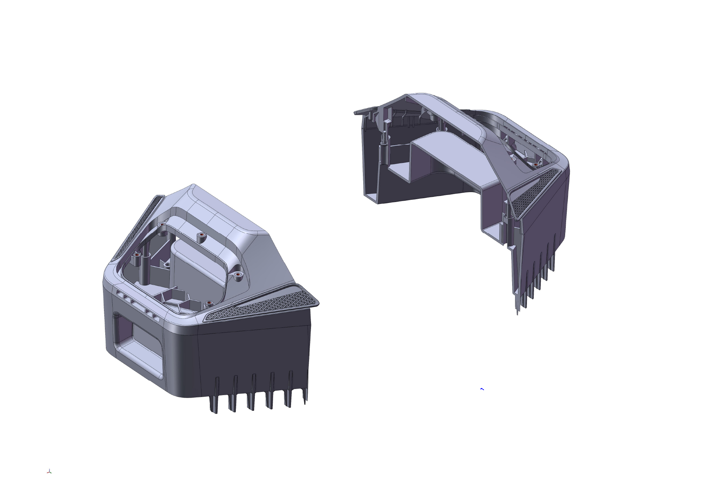

# TerraMow ModuleX Hub

  

---

This repository shares reference material for the TerraMow X side expansion bay.
The mechanical preview provides a mounting model, a CAD rendering, and an
engineering drawing with mounting-hole and screw-type information for the
community to explore ideas for future accessories.

## Current Preview

Snapshot: **November 11, 2026**.

| File | Purpose |
| --- | --- |
| [STEP mounting model ZIP](<mechanical/step/Terramow X Expansion Bay Mounting Model.STEP.zip>) | Compressed 3D reference model; about 20.9 MiB |
| [CAD rendering PDF](<mechanical/previews/Terramow X Expansion Bay Rendering.pdf>) | View the structure without CAD software |
| [Mounting-hole drawing PDF](<mechanical/drawings/Terramow X Expansion Bay Mounting Hole Drawing_A1.pdf>) | Mounting dimensions, hole types, and M4 / M5 screw notes |

This remains an early mechanical preview. The drawing adds mounting information;
a complete manufacturing and integration specification, electrical interfaces,
communication protocols, and firmware examples are still outside this package.
The snapshot date identifies the material revision, not a hardware interface version.

## Download and View

Open the PDFs using the links above. Download and extract the STEP ZIP, then
open the `.STEP` file in FreeCAD, SolidWorks, Fusion, or another STEP-compatible
CAD application.

For all three files together, use the
[GitHub Releases](https://github.com/TerraMow/modulex-hub/releases) package
**Expansion Bay Mechanical Preview — 2026-11-11**:
`terramow-x-expansion-bay-preview-2026-11-11.zip`. Extract that package, then
extract the model ZIP inside it to access the STEP file.

See the [model and drawing notes](mechanical/README.md) for the mounting-hole
preview, scope, and checksum verification.

## Compatibility

The model is a reference for the TerraMow X side expansion bay. Compatibility
with specific model variants and hardware revisions has not yet been documented.

## Updates

Follow [Releases](https://github.com/TerraMow/modulex-hub/releases) or the
[changelog](CHANGELOG.md) for new material. Additional reference files and
specifications will be shared as they become available.

## Support

Open an issue on [GitHub](https://github.com/TerraMow/modulex-hub/issues/new/choose)
for model questions, viewing problems, requests for reference information, or
accessory ideas.

## Contributing

Documentation improvements and feedback are welcome. See
[CONTRIBUTING.md](CONTRIBUTING.md) for contribution and release preparation
instructions. No physical module is needed to share an idea.

## License

This repository and its mechanical preview package are licensed under
[GNU GPL-3.0](LICENSE) (`GPL-3.0-only`). See the
[license scope](LICENSES/README.md) for details.
