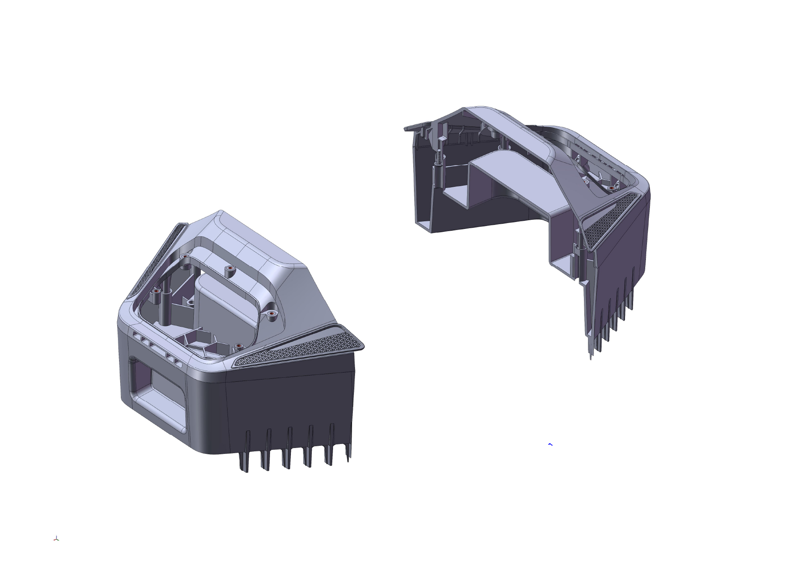
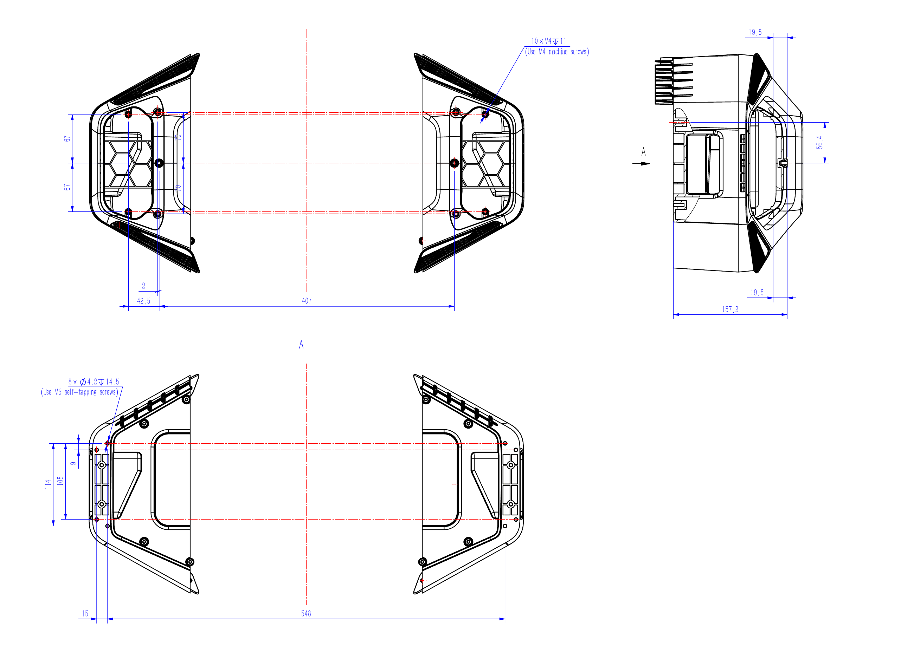

# Expansion Bay Mechanical Reference

[Repository overview](../README.md)

Current mounting-hole drawing revision: **A1**.

Snapshot: **2026-11-11**. This package contains a mounting reference model,
a CAD rendering, and a mounting-hole engineering drawing for the TerraMow X
side expansion bay.

## Files

| Location | Content | Format / size |
| --- | --- | --- |
| [Mounting model ZIP](<step/Terramow X Expansion Bay Mounting Model.STEP.zip>) | Compressed 3D reference geometry | ZIP, about 20.9 MiB; extracted STEP: 79.4 MiB |
| [CAD rendering](<previews/Terramow X Expansion Bay Rendering.pdf>) | Two perspective views of the supplied model | PDF, one A4 landscape page |
| [Mounting-hole drawing](<drawings/Terramow X Expansion Bay Mounting Hole Drawing_A1.pdf>) | Dimensioned mounting views and screw-type notes | PDF, one A3 landscape page |

```text
mechanical/
├── step/          ZIP containing the STEP reference model
├── previews/      CAD rendering PDF
├── drawings/      Mounting-hole engineering PDF
├── manifest.json  Snapshot, file sizes, and SHA-256 values
└── SHA256SUMS.txt  Checksums for the three reference files
```

## CAD Rendering



The image above is rendered from the supplied CAD preview PDF. Open the PDF for
its original resolution. The STEP header records SolidWorks 2022 as the exporter
and millimeters as the length unit.

## Mounting-Hole Drawing



The engineering drawing shows mounting-hole locations, dimensional references,
and two screw notes:

| Drawing callout | Screw note |
| --- | --- |
| 10 × M4, depth 11 | Use M4 machine screws |
| 8 × Ø4.2, depth 14.5 | Use M5 self-tapping screws |

Refer to the PDF for the exact symbols, locations, and dimensions. The depth
callouts do not specify screw length. Screw length, tightening torque, materials,
and tolerances are not defined by these notes. The drawing has no explicit unit
or general-tolerance statement; the STEP's millimeter setting does not replace
those missing drawing annotations.

These notes describe **mechanical mounting interfaces**. Electrical connector
types, pinouts, and communication interfaces are not specified in this drawing.

## Download and Integrity

The three source files are available directly from this directory. A combined
`terramow-x-expansion-bay-preview-2026-11-11.zip` package is prepared for
[Releases](https://github.com/TerraMow/modulex-hub/releases). It includes the STEP ZIP,
both PDFs, `PREVIEW-NOTES.md`, `LICENSE`, and `LICENSE-NOTICE.md`. Extract the model ZIP
to obtain `Terramow X Expansion Bay Mounting Model.STEP`.

To check a repository checkout, run from the repository root:

```bash
(cd mechanical && sha256sum -c SHA256SUMS.txt)
```

For a release download, save the ZIP and `SHA256SUMS.txt` in the same directory:

```bash
sha256sum --ignore-missing -c SHA256SUMS.txt
```

The same command checks extracted files when they are present. Machine-readable
file sizes and SHA-256 values, including the extracted STEP, are recorded in
[manifest.json](manifest.json).

## Scope

- The supplied drawing now provides mounting dimensions and screw-type guidance.
- Complete manufacturing tolerances, module loads, keep-out zones, assembly
  instructions, and validation requirements are not specified in this preview.
- Electrical interfaces, communication protocols, and software are not included.
- Specific retail-model and hardware-revision compatibility is not documented.
- CAD import, PDF rendering, and checksums do not validate fit or function.
- The published filenames and STEP name metadata use `Terramow X`. Only naming
  metadata was changed in the supplied STEP; its geometry was preserved.
- PDF title metadata uses the public name; workstation/user metadata was removed.
  The original page content was preserved.
- See [GPL-3.0 license scope](../LICENSES/README.md) before reusing any material.
